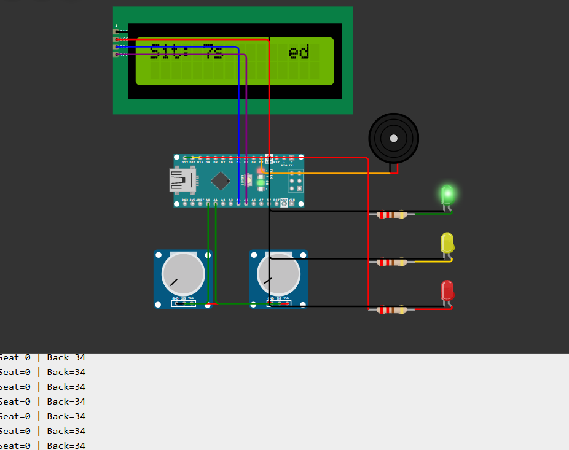
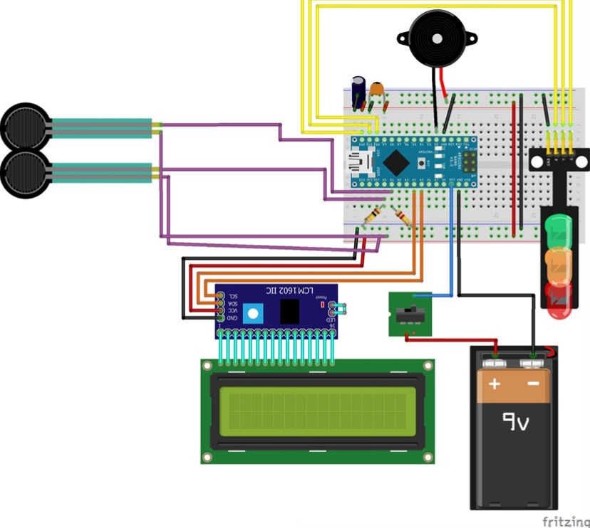
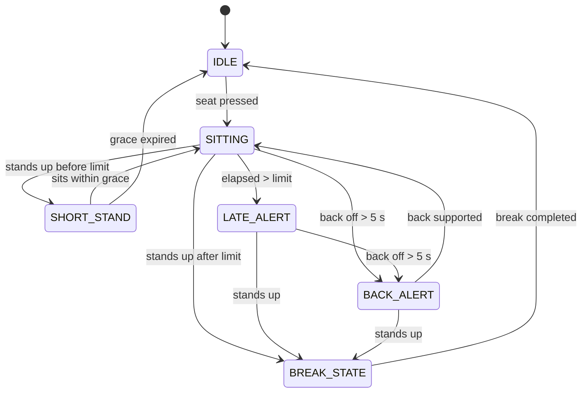

# MoveMind

A smart chair system that monitors **sitting time** and **back posture**, and reminds you to take standing breaks.

> 🎥 **[Watch the full demo video](https://drive.google.com/file/d/1uED5L_oNXGWH7ZeoH7DqNkgbj_3wuyK9/view?usp=drive_link)** (real chair, working prototype)

Built with an Arduino Nano, two force-sensing resistors (FSR402), a 16x2 I2C LCD, a traffic-light LED module, and a buzzer.

> Course project for **IE201** (Engineering Design), King Abdulaziz University, Fall 2025.
> Instructor: Abdulaziz Alhejaili.
> The documentation was rewritten later, and the simulation was rebuilt in Wokwi.

## Demo

- 🎥 Real-chair demo video: [Watch on Google Drive](https://drive.google.com/file/d/1uED5L_oNXGWH7ZeoH7DqNkgbj_3wuyK9/view?usp=drive_link)
- 💻 Simulation: [Open in Wokwi](https://wokwi.com/projects/477501713822927873)
- 📄 Poster: coming soon

## Problem

Prolonged sitting and poor posture are major contributors to muscular fatigue and chronic low back pain, which is often linked to psychological stress. Most people do not notice it while studying or working.

In our team survey (200+ respondents), **50%** said they had faced the problem of not sitting correctly on their chair.

## Solution

MoveMind turns a normal chair into a posture coach. It tracks how long you have been sitting, checks whether your back is supported, and gives visual and audible feedback when it is time to correct your posture or take a standing break.

## Design process

The idea was selected through a structured engineering design process:

1. **Problem finding:** brainstorming, Boggle method and multi-voting, then a survey and online research.
2. **Problem definition:** Duncker diagrams and statement/restatement.
3. **Idea selection:** Kepner-Tregoe Decision Analysis (KTDA). This idea scored highest (404 points) and passed all constraints.
4. **Risk and cost:** Kepner-Tregoe Potential Problem Analysis (lowest risk score among the top ideas) and a cost estimate of about 374 SAR.

## Components

| Component | Qty | Role |
|-----------|-----|------|
| Arduino Nano | 1 | Main controller: state machine and timing |
| FSR402 (seat) | 1 | Detects whether the user is sitting |
| FSR402 (back) | 1 | Detects whether the back touches the backrest |
| 16x2 LCD with I2C module | 1 | Shows state, time and messages |
| Traffic-light LED module | 1 | Green / Yellow / Red indicator |
| Buzzer (active LOW) | 1 | Audible alerts |
| Resistors | 5 | Voltage dividers for the FSRs and LED current limiting |
| Capacitors | 2 | Power supply stabilization |
| Breadboard | 1 | Prototyping the circuit |
| 9V battery + connector wire | 1 | Power supply |
| ON/OFF toggle switch | 1 | Power switch |

## Circuit

### Original design (Fritzing)

*Wiring diagram of the real build: Arduino Nano on a breadboard, two FSR sensors, I2C LCD, traffic-light LED module, buzzer, toggle switch and 9V battery.*

### Pin mapping

| Part | Arduino pin |
|------|-------------|
| Seat sensor | A0 |
| Back sensor | A1 |
| Buzzer | D2 |
| Green LED | D12 |
| Yellow LED | D11 |
| Red LED | D10 |
| LCD SDA / SCL | A4 / A5 (I2C address 0x27) |

> The real circuit uses FSR sensors with voltage dividers. The Wokwi simulation replaces them with potentiometers (which have a divider built in), since Wokwi has no FSR component. In both versions, pressed = low reading.

## Getting Started

### Requirements

- Arduino IDE
- Libraries: `Wire` (built in) and `LiquidCrystal_I2C`
- Arduino Nano and the parts listed in [Components](#components)

### Steps

1. Wire the circuit following the [pin mapping](#pin-mapping) and the Fritzing diagram.
2. Open `src/movemind.ino` in the Arduino IDE.
3. Install **LiquidCrystal I2C** from *Sketch > Include Library > Manage Libraries*.
4. Select **Arduino Nano** as the board and the correct port, then upload.
5. Open the Serial Monitor at **9600 baud** to see live `Seat` and `Back` sensor readings.

### Calibration

The code treats a reading below **50** as "pressed" and above **120** as "released" (seat sensor). If your FSRs and resistors give different values, read them from the Serial Monitor and adjust the thresholds in `seatPressedStable()`, `seatReleasedStable()` and `backPressedStable()`.

If the LCD stays blank, your module may use a different I2C address. Change `0x27` in `LiquidCrystal_I2C lcd(0x27, 16, 2);` (commonly `0x3F`).

## How it works

| State | What happens | LCD | LEDs / Buzzer |
|-------|--------------|-----|---------------|
| IDLE | Waits for someone to sit | "Waiting..." | Off |
| SITTING | Counts sitting time, monitors back | "Sit: Xs" | Green, then Yellow, then Red as the limit approaches |
| SHORT_STAND | 4 s grace period after standing early | "Short Stand" | Yellow |
| LATE_ALERT | Sitting limit (60 s) exceeded | "Time Exceeded!" | Solid red, beep every 3 s |
| BACK_ALERT | Back unsupported for more than 5 s | "Put Back!" | Yellow, beep every 3 s |
| BREAK_STATE | Standing break (12 s) with countdown | "Keep Standing / Remain: Xs" | Red, Yellow, then Green. Beep if the user sits early |

Settings in `src/movemind.ino`: sitting limit 60 s, break 12 s, back grace 5 s, short-stand grace 4 s, beep interval 3 s. The short limits are for demonstration; increase them for real use.

## Try the simulation

1. Open the Wokwi link above.
2. Move the **seat** slider to the left (sitting) to start a session.
3. Move the **back** slider to the right for 5 seconds to trigger "Put Back!".
4. Move the **seat** slider to the right (standing) to start the break.

## Files

- `src/movemind.ino`: Arduino code
- `simulation/diagram.json` and `libraries.txt`: Wokwi project
- `docs/`: circuit images and project documents

## Results

The system was built and tested on a real chair with the electronics mounted on it. See the demo video for the system in action.

## Challenges

- **Noisy FSR readings:** a stability filter (20 samples) must agree before a press or release is accepted.
- **Noise while standing:** a 1-second interruption grace in `BREAK_STATE` ignores sensor glitches so the break is not reset by mistake.
- **Floating inputs:** voltage dividers keep the analog pins at a defined level.
- **LCD library difference:** `lcd.begin()` failed in the simulator, and `lcd.init()` works.
- **Simulation:** Wokwi has no FSR, so potentiometers were used.

## Team

Team #1, IE201. All members worked on the project together:

- [Hamzah Abu-Askar](https://github.com/AbuAsker) (Team Leader)
- [Adel Eid Almutairi](https://github.com/ixnyp)
- [Ali Hasan Alfar](https://github.com/alialfar79)
- [Rakan Ali Alshehri](https://github.com/AeroRakan)

## Future work

- Adjustable sitting limit and break length
- More sensors for better posture detection
- Data logging and statistics
- Wireless notifications

## License

No license has been selected yet. All rights reserved by the project team.
Developed as part of the IE201 course at King Abdulaziz University.
Contact the team for permission to reuse any part of it.
